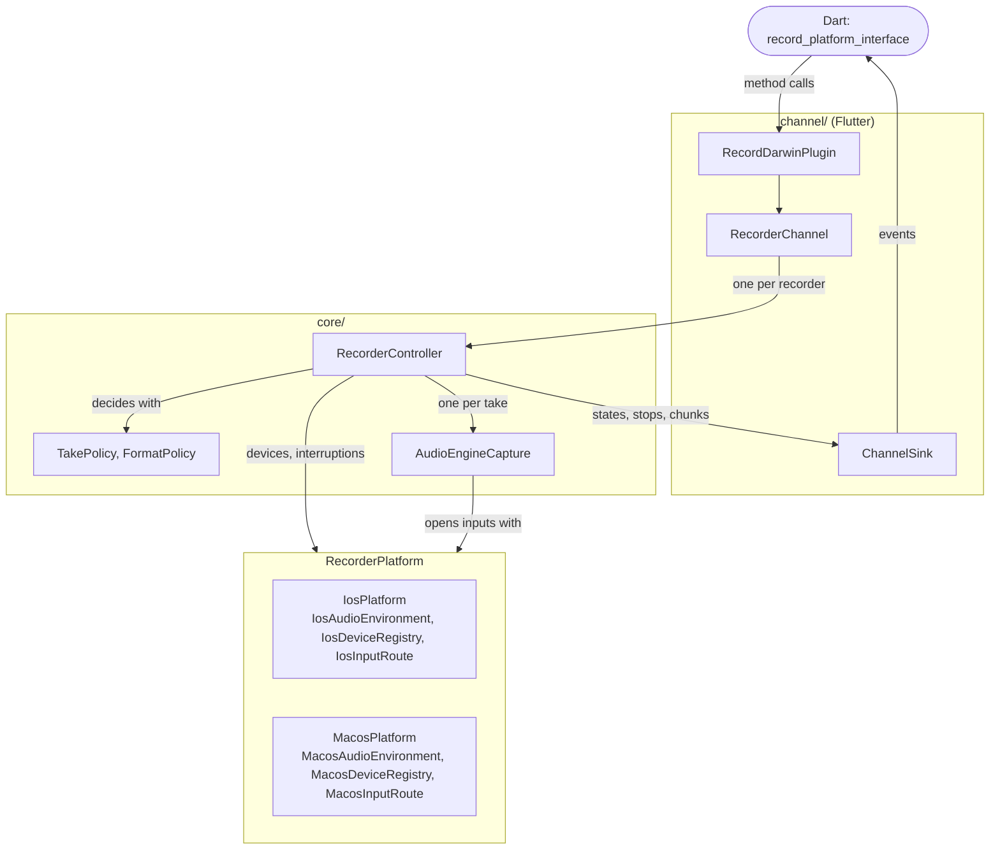
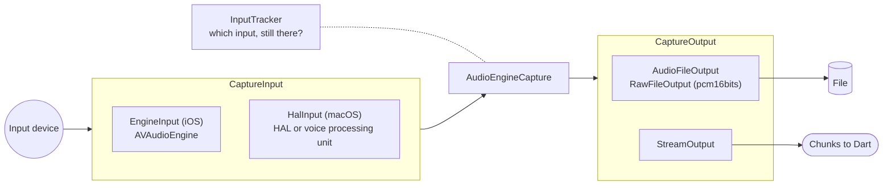

# record iOS & macOS

iOS & macOS implementations for record package called by record_platform_interface.

## Design

Sources are in `darwin/record_darwin/Sources/record_darwin`. Only `channel/` knows Flutter.
`core/` runs the takes. `ios/` and `macos/` give what changes between the two platforms.



One take: the input feeds one output until the take ends. When the input moves, a new input feeds the same output.



## Tests

Unit tests live in `darwin/Tests`. The example app builds them in its `RunnerTests` target, so
they run against the real plugin module on both platforms:

```sh
cd ../record/example

xcodebuild test -workspace macos/Runner.xcworkspace -scheme Runner -destination 'platform=macOS'

xcodebuild test -workspace ios/Runner.xcworkspace -scheme Runner -destination 'platform=iOS Simulator,name=iPhone 17'
```
